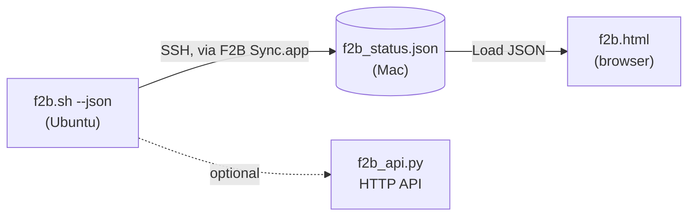

<p align="center"></p>

<h1 align="center">F2B Sync</h1>

<p align="center">
Get your Fail2Ban status from an Ubuntu server onto your Mac with one click,<br>
then explore it in a local dashboard. No web server to build or run.
</p>

---

## Scope: what is in this project

| Part | Runs on | Role | Required |
|---|---|---|---|
| `server/f2b.sh` | Ubuntu server | Reports **every** jail; `--json` exports it for machines | Yes |
| `mac/` (`f2b_sync.sh` and **F2B Sync.app**) | Mac | Pulls that JSON over one SSH connection | Yes |
| `dashboard/f2b.html` | Mac browser | Opens the JSON locally, no server | Yes |
| `server/f2b_api.py` | Ubuntu server | Standalone HTTP API with ready-made statistics | **No** (optional, independent) |

The main flow needs no web server anywhere. `f2b_api.py` is a separate extra: neither the sync client nor the dashboard uses it.



---

## 1. Server: `f2b.sh`

Copy it to the server and test it:

```bash
scp server/f2b.sh ubuntu@your-server.example.com:~/
ssh -t ubuntu@your-server.example.com 'chmod +x ~/f2b.sh && ./f2b.sh'          # colour report
ssh    ubuntu@your-server.example.com './f2b.sh --json'                         # writes ~/f2b_status.json
```

**It works on any Fail2Ban setup, with no configuration.** `f2b.sh` asks Fail2Ban for its jail list (`fail2ban-client status`) and loops over every jail it finds: `sshd`, Nginx jails, `recidive`, custom jails such as `ai-watchdog`. Add or remove a jail and the report follows automatically. For each jail the JSON contains:

- status (`active` if anything is currently banned, otherwise `idle`)
- currently and total banned, currently and total failed
- the log files being watched
- the banned IPs, each with a country

Country lookup is optional: install `geoip-bin` and `geoip-database` on the server (`sudo apt install geoip-bin geoip-database`). Without it the country shows as `--`.

Requirements: Fail2Ban running, and **passwordless sudo** for your SSH user (`f2b.sh` re-runs itself with `sudo`, and unattended syncs cannot type a password). Check with:

```bash
ssh ubuntu@your-server.example.com 'sudo -n true && echo "passwordless sudo OK"'
```

---

## 2. Mac: retrieve the JSON with the app

Configure once (the host is deliberately not hardcoded):

```bash
mkdir -p ~/.config && cp mac/f2b_sync.conf.example ~/.config/f2b_sync.conf
nano ~/.config/f2b_sync.conf     # set REMOTE_HOST, REMOTE_USER, SSH_KEY, LOCAL_DIR
```

Build and install the app (needs Xcode Command Line Tools: `xcode-select --install`):

```bash
cd mac && chmod +x build_app.sh f2b_sync.sh && ./build_app.sh --install
open ~/Applications/"F2B Sync.app"
```

The window shows a progress bar (key check, connect, run `f2b.sh` on the server, download, validate, save) and ends with **Sync complete** or **Sync failed** with Retry. The result is saved to `LOCAL_DIR/f2b_status.json` (default `~/f2b/f2b_status.json`). A failed sync never overwrites your last good file.

Prefer the Terminal? The same engine: `./f2b_sync.sh`. No Xcode tools? `./build_app_applescript.sh` builds a simpler progress-window version.

---

## 3. Load it locally in the dashboard

```bash
open dashboard/f2b.html          # or double-click the file
```

Then click **📁 Load JSON** and choose `f2b_status.json`. In the macOS file dialog, press `⌘⇧G` and type `~/f2b` to jump to the folder.

Daily routine: run **F2B Sync.app**, then click **📁 Load JSON** again in the dashboard to show the new data.

> A page opened by double-click (`file://`) cannot auto-read files from disk, and browsers block it. So the dashboard starts empty and the **🔄 Sync** button reports an error: that is expected. **Load JSON** always works.

---

## 4. Optional: the HTTP API (`f2b_api.py`)

Want live data over HTTP instead of a JSON file? `f2b_api.py` is a ready-made server in a **single file using only the Python 3 standard library**: no pip, no framework. This is its skeleton (abridged from the real file):

```python
#!/usr/bin/env python3
import os, sys, re, json, subprocess, logging
from http.server import HTTPServer, BaseHTTPRequestHandler
from urllib.parse import urlparse

# --- configuration: edit for your server -----------------------------------
JAIL_NAME         = "ai-watchdog"
WATCHDOG_LOG_PATH = "/var/log/ai-watchdog.log"
NGINX_ACCESS_LOG  = "/var/log/nginx/access.log"
NGINX_ERROR_LOG   = "/var/log/nginx/error.log"
HOST, PORT        = "0.0.0.0", 3000

ATTACK_CATEGORIES = { "WordPress / CMS Probing": [...], "SQL Injection (SQLi)": [...], ... }

def ensure_root():                    # re-executes itself through sudo
    if os.geteuid() != 0:
        os.execvp("sudo", ["sudo", sys.executable] + sys.argv)

def get_banned_ips_directly(): ...    # fail2ban-client status <jail>  + country
def get_ai_context_from_log(ip): ...  # AI decision / error rate from the watchdog log
def get_nginx_payloads(ip): ...       # up to 50 matching Nginx log lines
def classify_attacks(lines): ...      # labels the attack type(s)
def build_enriched_bans(): ...        # combines all of the above, per banned IP

class APIHandler(BaseHTTPRequestHandler):
    def do_GET(self):
        path = urlparse(self.path).path
        if   path == "/api/v1/bans":           ...   # every banned IP, enriched
        elif path.startswith("/api/v1/bans/"): ...   # one IP
        elif path == "/api/v1/stats":          ...   # ready-made statistics
        elif path == "/":                      ...   # health / version
        else:                                  ...   # 404
    def send_json_response(self, data, status=200): ...

if __name__ == "__main__":
    ensure_root()
    HTTPServer((HOST, PORT), APIHandler).serve_forever()
```

Start it:

```bash
scp server/f2b_api.py ubuntu@your-server.example.com:~/
ssh -t ubuntu@your-server.example.com 'python3 f2b_api.py'     # keep it running (tmux/screen/systemd for permanence)

# from the Mac, through an SSH tunnel (recommended)
ssh -N -L 3000:localhost:3000 ubuntu@your-server.example.com &
curl -s http://localhost:3000/api/v1/stats
```

**Statistics come pre-configured.** `/api/v1/stats` returns, without any setup:

- `total_active_bans`
- `attacks_by_type`, using 7 built-in categories: WordPress/CMS probing, sensitive config/dotfile exposure, path traversal (LFI), remote code execution, SQL injection, SSRF/cloud metadata, known scanners/bots
- `attacks_by_country`
- `ai_decisions`
- `top_adversaries`: the 10 IPs with the most captured events

| Endpoint | Returns |
|---|---|
| `GET /api/v1/bans` | all banned IPs with AI decision, error rate, attack types, sample payloads |
| `GET /api/v1/bans/{ip}` | one IP |
| `GET /api/v1/stats` | the statistics above |

**Know before you run it:**
- **Scope:** unlike `f2b.sh`, the API reads **one jail** (`JAIL_NAME`, default `ai-watchdog`) and expects the AI-Watchdog log and Nginx logs at the paths above. For another jail, change the constants at the top. Without the watchdog log, `ai_decision` shows `UNKNOWN`.
- **Security:** it listens on `0.0.0.0:3000` with **no authentication** and exposes attacker IPs and raw log lines. Keep port 3000 closed in your firewall or cloud security rules and use the SSH tunnel above. For a tighter default, set `HOST = "127.0.0.1"` (the tunnel still works).

---

## All commands, in order

```bash
# ── Server (once) ──────────────────────────────────────────────────────────
ssh-copy-id -i ~/.ssh/id_rsa.pub ubuntu@your-server.example.com      # skip if key login already works
ssh ubuntu@your-server.example.com 'sudo -n true && echo OK'          # passwordless sudo check
ssh ubuntu@your-server.example.com 'sudo apt install -y geoip-bin geoip-database'   # optional: countries
scp server/f2b.sh ubuntu@your-server.example.com:~/
ssh ubuntu@your-server.example.com 'chmod +x ~/f2b.sh && ./f2b.sh --json'  # test

# ── Mac (once) ─────────────────────────────────────────────────────────────
git clone https://github.com/github-deewhy/f2b-sync.git && cd f2b-sync
mkdir -p ~/.config && cp mac/f2b_sync.conf.example ~/.config/f2b_sync.conf
nano ~/.config/f2b_sync.conf                    # REMOTE_HOST, REMOTE_USER, SSH_KEY, LOCAL_DIR
(cd mac && chmod +x build_app.sh f2b_sync.sh && ./build_app.sh --install)

# ── Every time ─────────────────────────────────────────────────────────────
open ~/Applications/"F2B Sync.app"              # sync (or: mac/f2b_sync.sh)
open dashboard/f2b.html                         # then click "Load JSON" → ~/f2b/f2b_status.json

# ── Optional API ───────────────────────────────────────────────────────────
scp server/f2b_api.py ubuntu@your-server.example.com:~/
ssh -t ubuntu@your-server.example.com 'python3 f2b_api.py'
ssh -N -L 3000:localhost:3000 ubuntu@your-server.example.com &
curl -s http://localhost:3000/api/v1/stats
```

---

## Troubleshooting

| Symptom | Fix |
|---|---|
| Works in Terminal, fails in the app | Your key has a passphrase: `ssh-add --apple-use-keychain ~/.ssh/id_rsa`, and set `UseKeychain yes` / `AddKeysToAgent yes` in `~/.ssh/config`. |
| Sync fails right away | Run the passwordless-sudo check above. Connect once manually (`ssh user@host`) to accept the host key. |
| "invalid JSON received" | The remote script printed extra text on stdout; its messages must go to stderr. |
| Countries show `--` | Install `geoip-bin` and `geoip-database` on the server. |
| Dashboard is empty / Sync button errors | Expected when opened by double-click. Use **Load JSON**. |
| Can't write to the destination folder | Allow file access in System Settings → Privacy & Security, or change `LOCAL_DIR`. |

Log file: `~/Library/Logs/f2b_sync.log`

---

## Project structure

```
f2b-sync/
├── server/
│   ├── f2b.sh            # report + JSON export (all jails)
│   └── f2b_api.py        # optional HTTP API
├── dashboard/
│   └── f2b.html          # local dashboard (single file)
├── mac/
│   ├── f2b_sync.sh       # sync engine
│   ├── main.swift        # F2B Sync.app window
│   ├── build_app.sh
│   ├── build_app_applescript.sh
│   ├── f2b_sync.conf.example
│   └── icon.png
├── CHANGELOG.md
└── LICENSE
```

## License

[MIT](LICENSE) © 2026 DeeWHY
