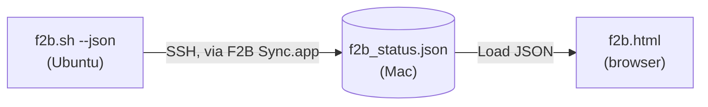

<p align="center"></p>

<h1 align="center">F2B Sync</h1>

<p align="center">
Get your Fail2Ban status from an Ubuntu server onto your Mac with one click,<br>
then explore it in a local dashboard. No web server to build or run.
</p>

---

## Scope: what is in this project

| Part | Runs on | Role | Required |
|---|---|---|---|
| `server/f2b.sh` | Ubuntu server | Reports **every** jail; `--json` exports it for machines | Yes |
| `mac/` (`f2b_sync.sh` and **F2B Sync.app**) | Mac | Pulls that JSON over one SSH connection | Yes |
| `dashboard/f2b.html` | Mac browser | Opens the JSON locally, no server | Yes |

The main flow needs no web server anywhere. Section 4 shows optional ways to use `f2b.sh` directly on the server.



---

## 1. Server: `f2b.sh`

Copy it to the server and test it:

```bash
scp server/f2b.sh ubuntu@your-server.example.com:~/
ssh -t ubuntu@your-server.example.com 'chmod +x ~/f2b.sh && ./f2b.sh'          # colour report
ssh    ubuntu@your-server.example.com './f2b.sh --json'                         # writes ~/f2b_status.json
```

**It works on any Fail2Ban setup, with no configuration.** `f2b.sh` asks Fail2Ban for its jail list (`fail2ban-client status`) and loops over every jail it finds, whatever your Fail2Ban is configured with (SSH, web server jails, `recidive`, your own jails). Add or remove a jail and the report follows automatically. For each jail the JSON contains:

- status (`active` if anything is currently banned, otherwise `idle`)
- currently and total banned, currently and total failed
- the log files being watched
- the banned IPs, each with a country

Country lookup is optional: install `geoip-bin` and `geoip-database` on the server (`sudo apt install geoip-bin geoip-database`). Without it the country shows as `--`.

Requirements: Fail2Ban running, and **passwordless sudo** for your SSH user (`f2b.sh` re-runs itself with `sudo`, and unattended syncs cannot type a password). Check with:

```bash
ssh ubuntu@your-server.example.com 'sudo -n true && echo "passwordless sudo OK"'
```

---

## 2. Mac: retrieve the JSON with the app

Configure once (the host is deliberately not hardcoded):

```bash
mkdir -p ~/.config && cp mac/f2b_sync.conf.example ~/.config/f2b_sync.conf
nano ~/.config/f2b_sync.conf     # set REMOTE_HOST, REMOTE_USER, SSH_KEY, LOCAL_DIR
```

Build and install the app (needs Xcode Command Line Tools: `xcode-select --install`):

```bash
cd mac && chmod +x build_app.sh f2b_sync.sh && ./build_app.sh --install
open ~/Applications/"F2B Sync.app"
```

The window shows a progress bar (key check, connect, run `f2b.sh` on the server, download, validate, save) and ends with **Sync complete** or **Sync failed** with Retry. The result is saved to `LOCAL_DIR/f2b_status.json` (default `~/f2b/f2b_status.json`). A failed sync never overwrites your last good file.

Prefer the Terminal? The same engine: `./f2b_sync.sh`. No Xcode tools? `./build_app_applescript.sh` builds a simpler progress-window version.

---

## 3. Load it locally in the dashboard

```bash
open dashboard/f2b.html          # or double-click the file
```

Then click **📁 Load JSON** and choose `f2b_status.json`. In the macOS file dialog, press `⌘⇧G` and type `~/f2b` to jump to the folder.

Daily routine: run **F2B Sync.app**, then click **📁 Load JSON** again in the dashboard to show the new data.

> A page opened by double-click (`file://`) cannot auto-read files from disk, and browsers block it. So the dashboard starts empty and the **🔄 Sync** button reports an error: that is expected. **Load JSON** always works. (To load it automatically, serve the dashboard over HTTP: see section 4.)

---

## 4. On the server: run it, schedule it, or serve it

`f2b.sh` is useful on its own. These options are all independent of the Mac client.

### Run it directly: a clear report in the terminal

```bash
./f2b.sh
```

Colour-coded when run in a terminal (it re-runs itself with `sudo` if needed). Example, abridged:

```text
+================================================================================================+
| FAIL2BAN - FULL REPORT                                                                         |
| 2026-10-10 22:13:20 UTC  |  4 jails                                                            |
+================================================================================================+

>> OVERVIEW
------------------------------------------------------------------------------------------------
  JAIL                       BANNED    TOTAL    FAILED   TOTFAIL   STATUS
  ............................................................................
  nginx-botsearch                 0        4         0        12   + idle
  nginx-http-auth                 0        0         0         0   + idle
  nginx-limit-req                 0        2         0        31   + idle
  sshd                            2       18         1       240   * active
  ----------------------------------------------------------------------------
  TOTAL (4)                       2       24         1       283

  ...

  +-- sshd
  | Filter
  |   Currently failed:  1
  |   Total failed:      240
  | Actions
  |   Currently banned:  2
  |   Total banned:      18
  |   Banned IPs:        2
  |     * 203.0.113.45       DE
  |     * 198.51.100.7       US
  +--
```

### Schedule it with cron: keep the JSON fresh

Add this to root's crontab (`sudo crontab -e`), so `sudo` is never involved. `--json` accepts an output path:

```cron
*/15 * * * * /home/ubuntu/f2b.sh --json /srv/f2b/f2b_status.json >/dev/null 2>&1
```

Create the folder first (`sudo mkdir -p /srv/f2b`) and adjust the schedule to taste.

### Serve it over HTTP: the dashboard straight from the server

Put the dashboard next to the JSON and serve that folder with Python's built-in web server (no installation needed):

```bash
# from your computer: copy the dashboard to the server
scp dashboard/f2b.html ubuntu@your-server.example.com:~/
ssh ubuntu@your-server.example.com 'sudo mkdir -p /srv/f2b && sudo mv ~/f2b.html /srv/f2b/'

# on the server: serve the folder (keep it running with tmux, screen or a systemd service)
cd /srv/f2b && python3 -m http.server 8080 --bind 127.0.0.1

# from your computer: open a tunnel, then browse to http://localhost:8080/f2b.html
ssh -N -L 8080:localhost:8080 ubuntu@your-server.example.com
```

Served over HTTP, the dashboard loads `f2b_status.json` automatically and its **Sync** button simply reloads it, so combined with the cron job above it always shows recent data.

> The report lists banned IP addresses and Python's built-in server has no login or HTTPS. Keep it bound to `127.0.0.1` and reach it through the SSH tunnel, or put a proper web server with authentication in front of it. Do not expose it publicly.

---

## All commands, in order

```bash
# ── Server (once) ──────────────────────────────────────────────────────────
ssh-copy-id -i ~/.ssh/id_rsa.pub ubuntu@your-server.example.com      # skip if key login already works
ssh ubuntu@your-server.example.com 'sudo -n true && echo OK'          # passwordless sudo check
ssh ubuntu@your-server.example.com 'sudo apt install -y geoip-bin geoip-database'   # optional: countries
scp server/f2b.sh ubuntu@your-server.example.com:~/
ssh ubuntu@your-server.example.com 'chmod +x ~/f2b.sh && ./f2b.sh --json'  # test

# ── Mac (once) ─────────────────────────────────────────────────────────────
git clone https://github.com/github-deewhy/f2b-sync.git && cd f2b-sync
mkdir -p ~/.config && cp mac/f2b_sync.conf.example ~/.config/f2b_sync.conf
nano ~/.config/f2b_sync.conf                    # REMOTE_HOST, REMOTE_USER, SSH_KEY, LOCAL_DIR
(cd mac && chmod +x build_app.sh f2b_sync.sh && ./build_app.sh --install)

# ── Every time ─────────────────────────────────────────────────────────────
open ~/Applications/"F2B Sync.app"              # sync (or: mac/f2b_sync.sh)
open dashboard/f2b.html                         # then click "Load JSON" → ~/f2b/f2b_status.json

# ── Optional, on the server ────────────────────────────────────────────────
ssh -t ubuntu@your-server.example.com './f2b.sh'          # readable report
sudo crontab -e                                           # on the server, then add:
#   */15 * * * * /home/ubuntu/f2b.sh --json /srv/f2b/f2b_status.json >/dev/null 2>&1
```

---

## Troubleshooting

| Symptom | Fix |
|---|---|
| Works in Terminal, fails in the app | Your key has a passphrase: `ssh-add --apple-use-keychain ~/.ssh/id_rsa`, and set `UseKeychain yes` / `AddKeysToAgent yes` in `~/.ssh/config`. |
| Sync fails right away | Run the passwordless-sudo check above. Connect once manually (`ssh user@host`) to accept the host key. |
| "invalid JSON received" | The remote script printed extra text on stdout; its messages must go to stderr. |
| Cron job does not update the file | Check `sudo crontab -l`, then run the same command by hand and read its output. |
| Countries show `--` | Install `geoip-bin` and `geoip-database` on the server. |
| Dashboard is empty / Sync button errors | Expected when opened by double-click. Use **Load JSON**. |
| Can't write to the destination folder | Allow file access in System Settings → Privacy & Security, or change `LOCAL_DIR`. |

Log file: `~/Library/Logs/f2b_sync.log`

---

## Project structure

```
f2b-sync/
├── server/
│   └── f2b.sh            # report + JSON export (all jails)
├── dashboard/
│   └── f2b.html          # local dashboard (single file)
├── mac/
│   ├── f2b_sync.sh       # sync engine
│   ├── main.swift        # F2B Sync.app window
│   ├── build_app.sh
│   ├── build_app_applescript.sh
│   ├── f2b_sync.conf.example
│   └── icon.png
├── CHANGELOG.md
└── LICENSE
```

## License

[MIT](LICENSE) © 2026 DeeWHY
