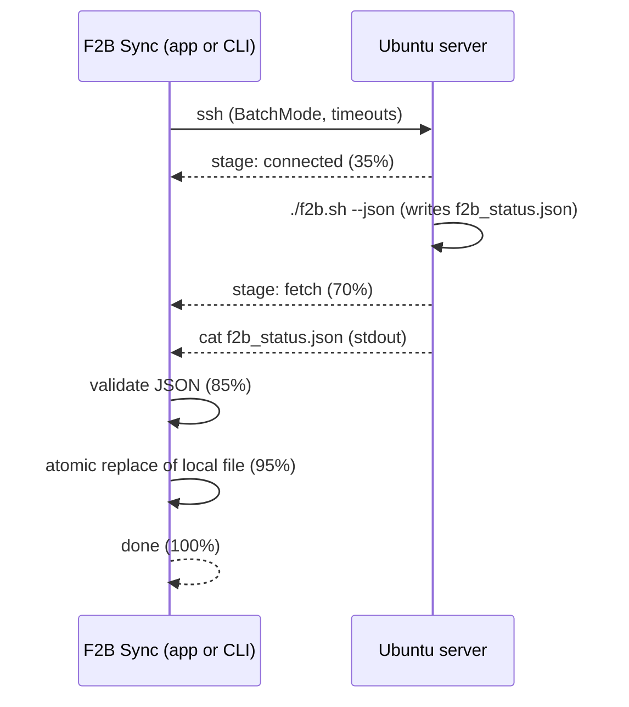

<p align="center"></p>

<h1 align="center">F2B Sync</h1>

<p align="center">
Fetch a Fail2Ban status JSON from a remote Ubuntu server to your Mac,<br>
from the Terminal or from a native app with a live progress bar.
</p>

<p align="center">


</p>

---

## Features

- **One SSH connection**: runs your remote script and streams the resulting JSON back in the same session (no separate `scp`).
- **Safe by design**: downloads to a temp file, validates the JSON, then replaces the target atomically. A failed or corrupt sync never overwrites a good file.
- **Resilient**: connection and keep-alive timeouts, `BatchMode` (never hangs on a prompt), configurable retries.
- **Native Mac app**: single window, real stage-based progress bar, final result with Close / Show Log / Retry.
- **Scriptable**: the same engine runs from the Terminal, with logs and optional notifications.
- **Configurable**: all settings in one config file, nothing hardcoded.

## How it works



## Requirements

**Mac**
- macOS 11 or later, `ssh` (built in)
- Xcode Command Line Tools to build the app (`xcode-select --install`). The CLI needs no extra tools.
- Optional: `jq` (otherwise `python3` or `plutil` validates the JSON)

**Server**
- SSH access with a key
- A script (default `~/f2b.sh --json`) that writes your status JSON to a known path (default `/home/ubuntu/f2b_status.json`). Its own status messages must go to stderr; only the file contents are streamed to stdout.

## Quick start

```bash
git clone https://github.com/github-deewhy/f2b-sync.git
cd f2b-sync

# 1. configure
mkdir -p ~/.config && cp f2b_sync.conf.example ~/.config/f2b_sync.conf
nano ~/.config/f2b_sync.conf          # set REMOTE_HOST, REMOTE_USER, LOCAL_DIR...

# 2a. run from the Terminal
chmod +x f2b_sync.sh && ./f2b_sync.sh

# 2b. or build and install the app
chmod +x build_app.sh && ./build_app.sh --install
open ~/Applications/"F2B Sync.app"
```

## Configuration

Defaults live at the top of `f2b_sync.sh`; override any of them in `~/.config/f2b_sync.conf` (plain shell syntax). Use `F2B_CONF=/path/to/file` to point at another config.

| Variable | Default | Description |
|---|---|---|
| `REMOTE_USER` | `ubuntu` | SSH user |
| `REMOTE_HOST` | `your-server.example.com` | Server hostname |
| `SSH_KEY` | `~/.ssh/id_rsa` | Private key |
| `REMOTE_CMD` | `./f2b.sh --json >&2` | Command run in the remote home directory |
| `REMOTE_FILE` | `/home/ubuntu/f2b_status.json` | File streamed back after the command succeeds |
| `LOCAL_DIR` | `~/f2b` | Destination folder |
| `LOCAL_NAME` | `f2b_status.json` | Destination file name |
| `RETRIES` | `3` | Attempts before giving up |
| `RETRY_DELAY` | `5` | Seconds between attempts |
| `LOG_FILE` | `~/Library/Logs/f2b_sync.log` | Log file |

## Command line

```bash
./f2b_sync.sh [--notify] [--quiet] [--progress] [--help]
```

| Flag | Effect |
|---|---|
| `--notify` | macOS notification with the result |
| `--quiet` | No human-readable output (still logged) |
| `--progress` | Emit machine-readable progress lines (used by the app) |

Exit codes: `0` success, `1` sync failed (existing file untouched), `2` invalid option.

### Progress protocol

With `--progress`, the script prints these lines on stdout:

```
@@PROGRESS <percent> <message>
@@DONE <exit-code> <message>
```

Stages: key check `3`, connecting `10`, server script running `35`, downloading `70`, validating `85`, saving `95`. Any other tool can drive its own UI from this output.

## The app

`./build_app.sh` compiles `main.swift` into `F2B Sync.app` (custom icon from `icon.png`, ad-hoc signed). The script is bundled inside the app, but settings still come from `~/.config/f2b_sync.conf`.

- `--install` copies the app to `~/Applications`.
- If `swiftc` is missing, use the simpler `./build_app_applescript.sh` (progress window plus result dialog).

**First launch:** macOS asks for permission to access your Desktop or Documents folder if `LOCAL_DIR` is there; click Allow. If macOS blocks the app, right-click it and choose Open. The icon cache can lag; `killall Dock` refreshes it.

## Troubleshooting

| Symptom | Fix |
|---|---|
| Fails immediately in the app but works in Terminal | Key has a passphrase. Run `ssh-add --apple-use-keychain ~/.ssh/id_rsa` and set `UseKeychain yes` / `AddKeysToAgent yes` in `~/.ssh/config`. |
| "SSH key not found" | Check `SSH_KEY` in your config. |
| "invalid JSON received" | The remote script printed extra text on stdout. Send its messages to stderr (`>&2`). |
| Cannot write to `LOCAL_DIR` | Allow file access in System Settings → Privacy & Security, or choose another folder. |
| First connection hangs or fails | `BatchMode` refuses unknown hosts: connect once manually (`ssh user@host`) to accept the host key. |

Always check `~/Library/Logs/f2b_sync.log`.

## Security notes

- Keys, configs, logs and the downloaded JSON are in `.gitignore`. Never commit them.
- `BatchMode=yes` means no password prompts: use key-based auth only, ideally a dedicated key for this job.
- The app is ad-hoc signed, not notarized. It is meant for personal use on the machine that built it.

## Project structure

```
f2b-sync/
├── f2b_sync.sh                  # sync engine (CLI)
├── main.swift                   # native single-window app
├── build_app.sh                 # builds the Swift app
├── build_app_applescript.sh     # fallback build (AppleScript applet)
├── f2b_sync.conf.example        # config template
├── icon.png                     # app icon source (1024 px)
├── CHANGELOG.md
└── LICENSE
```

## Roadmap

Built-in scheduling (minutes, hourly, daily, weekly, monthly) with launchd, a menu bar mode and an rsync transfer option. See [CHANGELOG.md](CHANGELOG.md).

## License

[MIT](LICENSE) © 2026 DeeWHY
